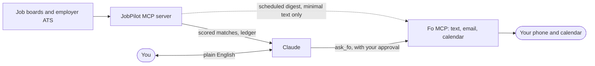

# JobPilot

JobPilot is a local, multi-seeker job-discovery service. Claude (or another
approved MCP client) orchestrates discovery and scoring; the server owns the
SQLite store, cross-board deduplication, source health, and notification
ledger.

## Current status

R3 adds the MCP server and Windows entry point. The post-R3 line also includes
the first R4 building block: config-driven official ATS JSON adapters for
Greenhouse, Lever, Workday, and SuccessFactors. Indeed India/US is currently
enabled. Naukri India is kept in the configuration but disabled after its live
canary returned HTTP 406 (recaptcha required); re-enable it only after a
deliberate cooldown retry. LinkedIn is intentionally not contacted.
No ATS endpoint is enabled until its exact public JSON URL is verified against
the employer careers page. Structured `JobPosting` JSON-LD pages are now also
supported as separately configured Layer 2 sources. The official Telegram
plugin is installed on the Windows desktop, and JobPilot now has a plain-text
digest plus a pinned, restricted launcher; a bot token and pairing are still
operator setup steps. A separate-process Wigolo wrapper boundary is now
supported for ordinary career pages, but no Wigolo executable is currently
configured on this machine. The MCP
surface also includes per-seeker status/history views, watchlists, and
explicit one-page browser-investigation handoffs.

## Fo x JobPilot (GSD hackathon)

JobPilot finds and scores jobs; [Fo](https://wajo.ai) (Wajo's assistant, reached over MCP) does the
real-world part: it texts you the matches, nudges you to follow up, and books the follow-up on your
calendar. Claude holds both MCP servers, so you ask in plain English.



What makes it more than glue:

- **Safe by design.** Fo can email, call and buy, and job posts are written by strangers. Fo only ever
  receives an id, a score and a vetted title/company, never reasoning or links. The host is pinned, the key
  never follows a redirect, and each application needs your explicit yes.
- **Never told twice.** A notification ledger records every delivery by channel; a failed send is retried,
  never counted as sent.
- **Facts-only applications.** `prepare_application` builds your application from your own saved resume
  facts. It cannot invent experience.
- **Tested.** 490+ offline tests, plus a test that starts the real MCP server and drives it like Claude.

**Hackathon scope.** JobPilot (discovery, scoring, ledger, resume engine, MCP server) existed before the
hackathon; Wajo's organizers confirmed a pre-built app is fine as long as it uses the Fo MCP. Built during the
hackathon (commits from Oct 17): the Fo client and delivery channel, the minimal-digest safety layer, follow-ups
through Fo, `prepare_application`, the fictional-data demo, and the real-server MCP test.

Try it in two minutes with fictional data: `python scripts/fo_demo.py` (dry run, sends nothing). See
[docs/FO-DEMO.md](docs/FO-DEMO.md) for the demo script and safety choices, and
[docs/APPLYING.md](docs/APPLYING.md) to use it for your own search.
Status: verified live: the interactive Claude + Fo path (texts, calendar) and the unattended digest through a
headless `claude -p` relay on your own Fo login (`[fo] transport = "claude"`; Fo confirmed receiving the exact
vetted message). Not available yet: Wajo has not released a headless API key or an inbound reply webhook, so a text
to Fo cannot trigger JobPilot. Both are on Wajo's roadmap, and the direct API-key transport is built and tested
with a fake Fo, ready for when the key exists.

**Tailored resumes.** `tailor_resume` ranks your own saved bullets and skills against a job's title and
description and lists the job terms your resume lacks (gaps to tell you about, never to invent). `render_resume`
then keeps and orders only those bullet ids. Nothing is written for you: every line comes from your resume.

## macOS development

```bash
python3.12 -m venv .venv
.venv/bin/python -m pip install -e ".[dev]"
.venv/bin/python -m pytest -q
.venv/bin/python scripts/demo.py
```

Register the server with Claude Code from the repository root:

```bash
claude mcp add jobpilot --scope user -- \
  "$PWD/.venv/bin/python" -m jobpilot.server
```

Set `JOBPILOT_HOME`, `JOBPILOT_DB`, and `JOBPILOT_OUT` in the MCP server
environment. Leave `JOBPILOT_SEEKER_ID` unset for the operator surface. A
seeker-facing process must set it to exactly one database seeker ID; that
removes roster and discovery tools and refuses other seeker IDs.

## Windows deployment

The intended project path is `E:\Github\Aasaan AI\jobpilot\`, not `C:`.

```powershell
& "C:\Users\Desktop\AppData\Local\Programs\Python\Python312\python.exe" -m venv .venv
.\.venv\Scripts\python.exe -m pip install -e ".[dev]"
.\run.ps1 -Task test
```

Use `run.ps1 -Task smoke` only after reviewing the live request plan. It uses
the explicit `--yes` acknowledgement and never contacts LinkedIn.

## Safety and privacy

Job descriptions and URLs are untrusted public data. The server never treats
instructions inside a scraped listing as commands. Seeker profiles,
resumes, the SQLite database, and generated digests are ignored by Git.

The service records notifications per seeker and posting, so a delivered job
is not returned as a new first notification. A source with a failed canary is
reported as blocked/error rather than as a quiet job market.

Do not commit `data/seekers/`, databases, generated output, Telegram tokens,
or other personal data. The repository is private on GitHub, but privacy still
depends on keeping those paths untracked.

The optional Google Sheets exporter is one-way: SQLite remains authoritative,
and the exporter grants only a direct reader permission to the seeker's email.
Install it with `pip install -e ".[dev,sheets]"` only when an operator-owned
service-account file is ready.
