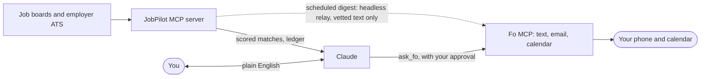

# JobPilot × Fo

> **New here?** *Fo* is [Wajo's](https://wajo.ai) AI assistant, which can act in the real world (text, email, calendar) and is
> reachable over MCP (the Model Context Protocol, the standard way to give Claude tools). *GSD* is the weekend hackathon this
> was built for. *JobPilot* is the job-search engine underneath (it existed before the hackathon).

[](https://github.com/4asaanAI/job-seeker/actions/workflows/tests.yml)

**Who it is for:** anyone running a job search who wants an assistant that can act (text, email, calendar) without letting
strangers' job posts steer it.

**Claude finds and judges the jobs. [Fo](https://wajo.ai) (Wajo's assistant, over MCP) does the real-world part: it texts me the matches,
can apply when I say yes (verified on the request side; the one live attempt stopped at a phone-code login), and adds an interview to my calendar only when the company sends the invite.** One Claude session holds both MCP servers; you just ask in plain English.
Built for the GSD hackathon. JobPilot already existed; the Fo link, the safety layer, tailored resumes and the
unattended digest are what was built for it.

> Fo can email, call and buy, and job posts are written by strangers. So JobPilot never forwards a job post to Fo: digests carry only an id,
> a score and a vetted title. (When you ask Fo to apply, it opens the company's own page itself, which is why every request is
> vetted and every Fo action asks permission first.)

## Using it with Claude Code (macOS or Linux)

Copy `.mcp.fo-demo.json.example` to `.mcp.json` (the older `.mcp.json.example` is the Windows layout), set `JOBPILOT_PYTHON`,
`JOBPILOT_DB`, `JOBPILOT_OUT` and `JOBPILOT_SEEKER_ID`, start Claude Code, and log in to Fo with `/mcp`. New to it? Start with [docs/GETTING-STARTED.md](docs/GETTING-STARTED.md), or run `python -m jobpilot.onboard --help`, then `python -m jobpilot.doctor`; steps are in `docs/APPLYING.md`. One-call status: `my_dashboard`. Login-gated jobs: `manual_apply_packet`.

## Try it in three minutes (no accounts, nothing is sent)

```bash
python3.12 -m venv .venv && .venv/bin/python -m pip install -e ".[dev]"
.venv/bin/python scripts/injection_demo.py   # a poisoned job posting is neutralized before Fo sees it
.venv/bin/python scripts/fo_demo.py          # dry run on a fictional seeker: the exact messages Fo would get
.venv/bin/python -m pytest -q                # 890+ offline tests, including one that starts the real MCP server
.venv/bin/python -m jobpilot.setup           # your own profile and resume in one guided command (asks before writing anything)
```

## What is new for the hackathon

- **Fo delivery with a safety layer.** A minimal digest (id, score, vetted title), random-marker wrapper, host-pinned
  client that never follows redirects, and "delivered" only when Fo confirms. One Fo account serves exactly one seeker.
- **Two transports, both verified live.** `api` (a Wajo API key from `FO_API_KEY` or a private `~/.config/jobpilot/fo_api_key`:
  one text came back complete in 46 seconds with Fo's reply text) and `claude`, a headless `claude -p` relay on your own Fo
  login with only Fo's send/poll tools.
- **Tailored resumes, facts-only.** `tailor_resume` ranks your own bullets and skills against a job and lists the
  job terms your resume lacks. `render_resume` can only keep and reorder what your resume already says.
- **Text Fo, JobPilot answers.** Wajo has no inbound webhook yet, but Fo's MCP can read your own conversation
  transcripts. `python -m jobpilot.inbox --once` polls them through a headless relay, accepts a strict read-only
  grammar (`jp matches`, `jp status`, `jp tailor <id>`) re-checked in Python, runs JobPilot locally and replies
  through Fo. Commands never apply, email or change a job's status. Design: [docs/superpowers/specs/2026-10-18-fo-inbox-design.md](docs/superpowers/specs/2026-10-18-fo-inbox-design.md).
- **"Apply to all my new jobs".** `plan_apply_batch` lists the jobs Fo can plausibly complete; you give one yes; each
  application is a vetted request that stops at anything not in your resume. Max 10 a day.
- **Applying through Fo, on your yes.** `build_fo_apply_message` builds one vetted request per job (safe link, your resume text,
  "ask me before submitting", **no calendar event**). A calendar entry appears only when the company itself sends an invitation
  (`build_fo_reply_check_message`). Nothing is sent by JobPilot; every `ask_fo` passes Claude Code's permission prompt.
- **A living job record in Google Sheets, kept by Fo.** Fo created the "JobPilot Tracker" sheet in my Drive and filled it with 82 real
  jobs, then handed back its link. JobPilot saves that link, opens the sheet by id from then on, and puts "Your job tracker: <link>"
  in every digest. Ask Fo in iMessage for the link and it texts it; on-demand refreshes text one update line with the link. Statuses
  (match, started, applied, interview, rejected, offer, deadline passed, stale) are kept current, never deleted.
- **Google Docs through Fo.** Each
  job's tailored resume as a Google Doc (`jp doc <id>`) or a facts-only cover letter (`jp letter <id>`). Details in [docs/APPLYING.md](docs/APPLYING.md).
- **Real-server test.** The MCP server is started over stdio and driven like Claude would, including seeker pinning.



## Built this weekend (Oct 17-18)

JobPilot (discovery, scoring, ledger, resume engine, MCP server) predates the hackathon. Everything below is new, and you can
diff it yourself: [all changes since the last pre-hackathon commit](https://github.com/4asaanAI/job-seeker/compare/bf935c7...main).

| New | Where |
|---|---|
| Fo MCP client, vetted digest, headless relay, delivery confirmation | `src/jobpilot/fo.py`, `notify.py`, `scheduled.py` |
| Safe applying (vetted request, route check, approved batch, no calendar until the company writes) | `src/jobpilot/apply.py`, `server.py` |
| Facts-only resume tailoring | `src/jobpilot/resume/tailor.py` |
| Search, score and list on demand | `src/jobpilot/refresh.py` |
| One-command setup, resume builder, facts-only cover letter | `src/jobpilot/setup.py`, `resume/build.py`, `resume/letter.py` |
| Text-Fo inbox (experimental; texts typed in iMessage are NOT visible to it, see KNOWN-LIMITS; includes jp apply / jp yes, jp replies and outcome commands) | `src/jobpilot/inbox.py` |
| Injection attack demo and fictional-data demo | `scripts/injection_demo.py`, `scripts/fo_demo.py` |
| Real-server MCP tests (listing, pinning, malformed and hostile input) | `tests/test_mcp_judge.py`, `tests/test_mcp_stdio.py` |
| Two independent code reviews, fixes and known limits | `docs/KNOWN-LIMITS.md` |

About 20,000 lines of code, tests and scripts in 190+ commits; 897 tests.

## Where the Fo MCP is used

| Fo tool | What JobPilot does with it | Safety |
|---|---|---|
| `ask_fo` | Text me the new matches (digest) and follow-ups | Vetted id, score and title only, random-marker wrapper |
| `ask_fo` | Create and update the Google Sheet job record, return its link, text me one update line | Rows vetted; "only files I own", no sharing, never delete or move a status backwards |
| `ask_fo` | Apply to a job on my yes: resume text, optional PDF from a Google Doc | One request per job, safe link, Fo asks before submitting, no calendar event |
| `ask_fo` | Resume and cover-letter Docs, reply check, calendar entry only when a company sends an invite | Each request is built and vetted in Python; every `ask_fo` passes Claude Code's permission prompt |
| `get_fo_reply` | Wait for a long Fo turn to finish ("working" to "complete") | Only `complete` counts as delivered |
| `list_fo_conversations`, `get_fo_conversation` | Read-only: the polling inbox looks for `jp ...` texts | Re-checked in Python; cannot see iMessage texts (see KNOWN-LIMITS) |
| `start_fo_call` | Not used, and explicitly denied to the relays | Calls are never needed |

## Honest status

| Verified live (Oct 17-19, my real profile) | Built and tested, not live |
|---|---|
| Claude -> Fo texts and calendar create/delete | Applying end to end: the form fill, a PDF upload into a form, a company-sent interview invite |
| Direct Fo **API** with a Wajo key, and the headless `claude` relay | Google Docs, Slides, cover letters and the one-command setup wizard (tested with a fake Fo) |
| A real search of Indeed, foundit and Himalayas (216 + 289 + 114 jobs), scoring, a digest texted by Fo | `jp ...` texts answering from iMessage: **not possible today**, Fo's transcript API returns only Fo's own messages in SMS threads, never yours (checked live; needs Wajo's inbound webhook) |
| Fo built the Google Sheet job record (82 real rows) and handed back its link; Fo texted the link when asked in iMessage | |

More: [docs/FO-DEMO.md](docs/FO-DEMO.md) (demo and safety choices) · [docs/APPLYING.md](docs/APPLYING.md) (using it for your own search).

---

## Background: JobPilot itself

JobPilot is a local, multi-seeker job-discovery service. Claude (or another
approved MCP client) orchestrates discovery and scoring; the server owns the
SQLite store, cross-board deduplication, source health, and notification
ledger.

## Current status

R3 adds the MCP server and Windows entry point. The post-R3 line also includes
the first R4 building block: config-driven official ATS JSON adapters for
Greenhouse, Lever, Workday, and SuccessFactors. Indeed India/US is currently
enabled. Naukri India is kept in the configuration but disabled after its live
canary returned HTTP 406 (recaptcha required); re-enable it only after a
deliberate cooldown retry. LinkedIn is intentionally not contacted.
No ATS endpoint is enabled until its exact public JSON URL is verified against
the employer careers page. Structured `JobPosting` JSON-LD pages are now also
supported as separately configured Layer 2 sources. The official Telegram
plugin is installed on the Windows desktop, and JobPilot now has a plain-text
digest plus a pinned, restricted launcher; a bot token and pairing are still
operator setup steps. A separate-process Wigolo wrapper boundary is now
supported for ordinary career pages, but no Wigolo executable is currently
configured on this machine. The MCP
surface also includes per-seeker status/history views, watchlists, and
explicit one-page browser-investigation handoffs.

## macOS development

```bash
python3.12 -m venv .venv
.venv/bin/python -m pip install -e ".[dev]"
.venv/bin/python -m pytest -q
.venv/bin/python scripts/demo.py
```

Register the server with Claude Code from the repository root:

```bash
claude mcp add jobpilot --scope user -- \
  "$PWD/.venv/bin/python" -m jobpilot.server
```

Set `JOBPILOT_HOME`, `JOBPILOT_DB`, and `JOBPILOT_OUT` in the MCP server
environment. Leave `JOBPILOT_SEEKER_ID` unset for the operator surface. A
seeker-facing process must set it to exactly one database seeker ID; that
removes roster and discovery tools and refuses other seeker IDs.

## Windows deployment

Pick a project folder outside the system drive, for example `D:\jobpilot\` (the examples below call it `<project>`).

```powershell
& "C:\Users\Desktop\AppData\Local\Programs\Python\Python312\python.exe" -m venv .venv
.\.venv\Scripts\python.exe -m pip install -e ".[dev]"
.\run.ps1 -Task test
```

Use `run.ps1 -Task smoke` only after reviewing the live request plan. It uses
the explicit `--yes` acknowledgement and never contacts LinkedIn.

## Safety and privacy

Job descriptions and URLs are untrusted public data. The server never treats
instructions inside a scraped listing as commands. Seeker profiles,
resumes, the SQLite database, and generated digests are ignored by Git.

The service records notifications per seeker and posting, so a delivered job
is not returned as a new first notification. A source with a failed canary is
reported as blocked/error rather than as a quiet job market.

Do not commit `data/seekers/`, databases, generated output, Telegram tokens,
or other personal data. This repository is public, so privacy depends
entirely on keeping those paths untracked (they are in `.gitignore`).

The optional Google Sheets exporter is one-way: SQLite remains authoritative,
and the exporter grants only a direct reader permission to the seeker's email.
Install it with `pip install -e ".[dev,sheets]"` only when an operator-owned
service-account file is ready.
